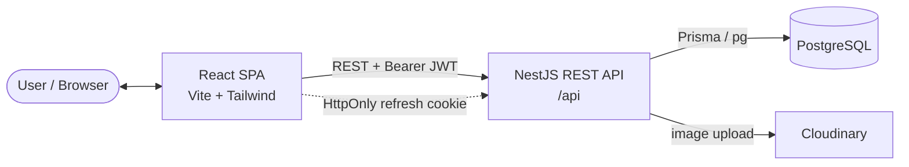
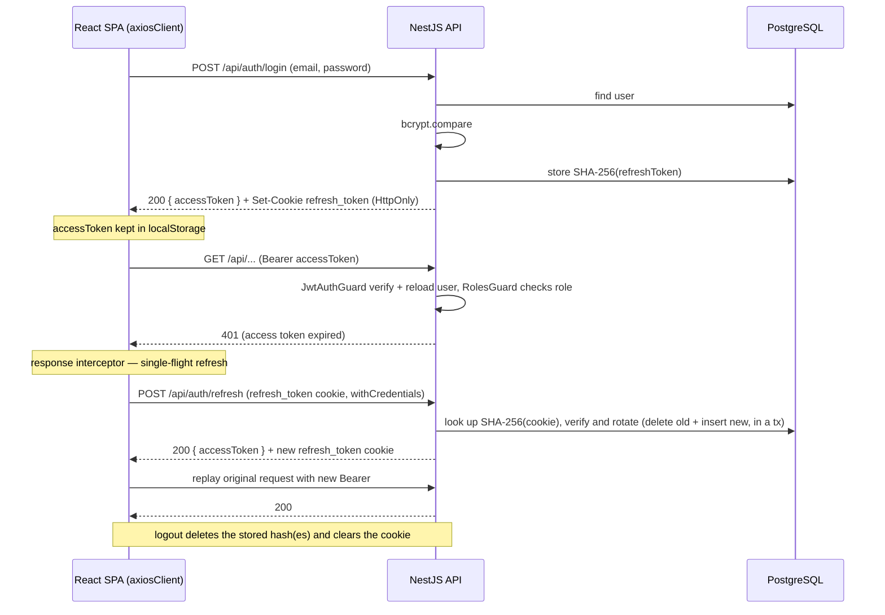
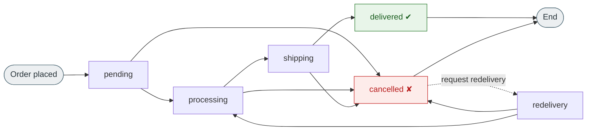

# System Architecture

## 1. High-Level Overview

**Tech stack**

| Layer         | Technology                                                            |
|---------------|-----------------------------------------------------------------------|
| Frontend      | React 19, TypeScript, Vite, Tailwind CSS v4, React Router, Axios       |
| Backend       | NestJS 12, Prisma 7 (`pg` adapter)                                     |
| Database      | PostgreSQL (schema, functions, triggers as raw SQL — see [`database/`](../database/)) |
| Storage/Media | Cloudinary (avatar & product image upload)                            |

**System context**



The SPA holds a short-lived access token and calls the API with `Authorization: Bearer`; the refresh
token travels only as an `HttpOnly` cookie. The API is the sole writer to PostgreSQL and the only
caller of Cloudinary.

## 2. Repository & Directory Structure

Dual-app layout: the repo root is the frontend; `backend/` is the NestJS server.

### 2.1 Frontend (`src/`)

```
src/
  api/           Axios client + per-domain API modules (axiosClient, orderApi, productApi, cartApi, ...)
  components/    Reusable UI (Header, Footer, ProductCard, CartItemCard, DropDownSelector,
                 Pagination, Modal, FormField, StarRating, StatusBadge, Avatar, ...)
  pages/         Route screens w/ subcomponents: Home, ProductList, ProductDetails, Cart,
                 Checkout, Orders, Login, Profile, Dashboard (admin/manager)
  config/        Env-driven runtime config (reads VITE_* vars)
  constants/     routes (ROUTES), catalog, commerce, order, storage keys
  utils/         auth (token/user helpers), pricing, format, cartCount
  types/         Shared TypeScript types
  router.tsx     React Router route tree
```

### 2.2 Backend (`backend/src/`)

Feature modules, each `*.module.ts` + `*.controller.ts` + `*.service.ts`, with `dto/`
(class-validator) and `entities/` where present.

```
backend/src/
  auth/          register / login / refresh / logout, JWT issuing
  users/         user CRUD, profile, password change
  products/      products + product-stock variants (price/stock), price-range
  comments/      product reviews + review eligibility
  cart/          per-user cart and cart items
  orders/        orders, order items, redelivery orders
  promos/        promo codes
  cloudinary/    image upload
  prisma/        PrismaService (pg adapter)
  guards/        JwtAuthGuard (global), RolesGuard
  common/
    decorators/  @Public, @Roles, @CurrentUser
    filters/     HttpExceptionFilter
  main.ts        bootstrap: cookie-parser, CORS (credentials), global ValidationPipe, '/api' prefix
```

### 2.3 Architectural conventions

- **Centralized routes** — `ROUTES` in `src/constants/routes.ts` (path builders for product/order
  detail; `ORDER_DETAIL` is marked not implemented yet).
- **Shared helpers** — `formatPrice` / `formatDate` / `formatDateTime` (`utils/format.ts`) and
  pricing helpers (`getCardPrice`), so formatting is consistent across pages.
- **Reusable UI primitives** — `FormField`, `DropDownSelector`, `StatusBadge`, `SubmitButton`, etc.,
  used in place of raw inputs.
- **Single Axios client** (`src/api/axiosClient.ts`) — a request interceptor attaches the Bearer
  token and strips `Content-Type` for `FormData`; a response interceptor does silent refresh on
  `401` (§3), retry-with-backoff for idempotent methods (408/429/5xx), and global error toasts via
  `react-toastify`. The refresh call uses `withCredentials` to send the `HttpOnly` cookie.

## 3. Authentication & RBAC

- **Tokens** — On register/login the server issues a short-lived **JWT access token** (JSON body;
  sent as `Authorization: Bearer`) and a **refresh token** as an **HttpOnly cookie**
  (`refresh_token`, `sameSite=lax`, `secure` in production, 7-day expiry). The refresh token is also
  stored server-side as a **SHA-256 hash** in `refresh_tokens`, so it can be revoked and is rotated
  on every refresh.
- **Guards** — `JwtAuthGuard` is registered **globally** (`APP_GUARD`): every route needs a valid
  access token unless marked `@Public()` (register, login, refresh, logout). It verifies the JWT,
  reloads the user from the DB, and attaches it to the request. `RolesGuard` (per route, via
  `@Roles(...)`) checks the user's `role`.

### 3.1 Token lifecycle (login, silent refresh, logout)



Logout (`POST /auth/logout`) deletes the current refresh-token hash and clears the cookie;
`POST /auth/logout-all` deletes every refresh token for the user.

### 3.2 Authorization matrix

| Capability                                               | customer | manager | admin |
|----------------------------------------------------------|:--------:|:-------:|:-----:|
| Storefront, own cart, place orders, own profile          |    ✓     |    ✓    |   ✓   |
| Write product reviews (after a delivered purchase)        |    ✓     |    ✓    |   ✓   |
| Products & stock, promo codes                            |          |    ✓    |   ✓   |
| All orders (list/update), redelivery management          |          |    ✓    |   ✓   |
| User management (list/update users)                      |          |         |   ✓   |

## 4. Core Domain & Business Flows

### 4.1 Order & Redelivery lifecycle

Enforced in **two** places: the [`update_order_status`](../database/README.md#functions--triggers)
Postgres trigger (`database/functions.sql`) and `assertValidRedeliveryTransition` in
`orders.service.ts`.



| From         | Allowed → to                  |
|--------------|-------------------------------|
| `pending`    | `processing`, `cancelled`     |
| `processing` | `shipping`, `cancelled`       |
| `shipping`   | `delivered`, `cancelled`      |
| `redelivery` | `processing`, `cancelled`     |
| `delivered`  | terminal                      |
| `cancelled`  | terminal (may spawn a redelivery) |

A redelivery is a **new `redelivery_orders` record linked to a `cancelled` order** (admin/manager
only, one active per order) — the original order is not mutated. It copies
address/contact/total/payment from the order and runs its own status machine starting at
`redelivery`.

### 4.2 Checkout & inventory consistency

- **Atomic checkout** (`POST /orders`, customer) — one transaction: validate the cart isn't empty
  and each item has stock, compute `subtotal` from `promotionPrice ?? originalPrice`, apply a promo
  (fixed or percent, with `minToApply` / `maxDiscountNum`; capped at subtotal), snapshot
  title/image/price into `order_items`, **decrement stock** (guarded `updateMany` — if 0 rows match,
  the whole order rolls back), and clear the cart. `total` is a DB-generated column.
- **Restock is manual.** Cancelling an order does **not** return stock automatically; admins/managers
  add stock via the product-stock endpoints (a stock-only update **increments** existing stock).
- **Stock-drop safety net** — the [`clamp_cart_items_to_stock`](../database/README.md#functions--triggers)
  trigger clamps cart items to available quantity (or deletes them at 0) when a variant's stock drops.

### 4.3 Catalog, filtering & reviews

- **Price-range bounds** — `getRoundedPriceRange` aggregates min/max across all non-deleted variants
  (original & promotion prices) and rounds out (`niceFloor` / `niceCeil`); the frontend uses it for
  the filter slider. Product listing also filters by `minPrice` / `maxPrice`, search and pagination.
- **Cold-start** — products with no comments keep `rating = 0` / `num_reviews = 0` (shown as "New").
- **Review aggregation** — the `update_product_rating` trigger keeps `products.rating` (avg) and
  `num_reviews` in sync with `comments`. A user may review a product **only after a `delivered`
  order containing it, and only once** (`checkEligibility`).

## 5. Key Design Decisions & Trade-offs

- **Refresh token in an `HttpOnly` cookie (hashed in DB), access token in `localStorage`** — the
  long-lived credential is kept out of JS reach (XSS) and is revocable/rotating; the short-lived
  access token stays convenient for the `Bearer` header.
- **Separate `Order` and `RedeliveryOrder` records** instead of mutating a terminal `cancelled`
  order — preserves order history and allows one tracked redelivery per order.
- **Money as `DECIMAL` with generated columns** (`orders.total`, `order_items.total_price`) — totals
  are computed once, in the database, not trusted from the client.
- **Derived product fields via DB triggers** (`price`, `rating`, `num_reviews`) — a single source of
  truth no matter which code path writes stock or comments.
- **Centralized Axios interceptors** — one place for silent token refresh and consistent toast error
  feedback across the whole SPA.
- **Schema as raw SQL, not Prisma migrations** — the database owns its constraints, functions and
  triggers; `schema.prisma` only mirrors it for the client.
